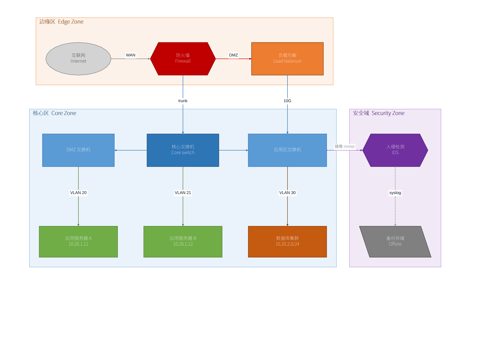

# Agent VSDX Engine

**在未安装 Microsoft Visio 的环境中，创建、读取、增量修改并渲染真实的 VSDX 图形文件。**

一套独立图形工具（CLI + C# API）加一份通用 Agent Skill。输出是结构正确的 OPC/VSDX 包，
不是改了扩展名的图片；预览图由**保存后的 VSDX 本身**渲染，不是另外画一张 SVG 充数。

```
JSON 模型  ──create──▶  VSDX  ──render──▶  PNG / SVG
   ▲                      │
   └────export-model──────┘
                          │
               update ────┘   在已有 VSDX 上增量修改，未改对象原样保留
```

- 后端：OfficeIMO.Visio，锁定版本见 [`Directory.Packages.props`](Directory.Packages.props)
- SDK：.NET 8，精确版本见 [`global.json`](global.json)
- 运行时不访问网络
- 许可证：MIT

---

## 为什么需要它

AI Agent 能画出漂亮的图，但产出通常是 PNG 或 SVG——一次性快照，无法回到 Visio 里继续编辑。
VSDX 本身是 ZIP/OPC + XML 的开放包，程序完全可以读写，难点在于：

- 常规库没有"读 VSDX → 改一个节点 → 只保存差异"这条路
- 重命名一个节点，很容易变成"删除旧形状 + 新建形状"，原有 ID 与连接关系全丢
- 中文渲染需要额外处理字体，否则全是缺字方框
- 文件"能打开"和"结构正确"是两件事

这个项目把这些坑填了，并把结论写成可执行的测试。

---

## 快速开始

```bash
git clone <this-repo> agent-vsdx && cd agent-vsdx
dotnet build -c Release

# 创建
dotnet run --project src/Vsdx.Cli -c Release -- create \
  --input examples/architecture.json --output out/architecture.vsdx

# 渲染预览（PNG 会自动挑选 CJK 字体）
dotnet run --project src/Vsdx.Cli -c Release -- render \
  --input out/architecture.vsdx --format png --output out/architecture.png --dpi 120

# 结构校验
dotnet run --project src/Vsdx.Cli -c Release -- validate --input out/architecture.vsdx

# 布局质量
dotnet run --project src/Vsdx.Cli -c Release -- check-layout --input out/architecture.vsdx
```

构建后可直接调用 `src/Vsdx.Cli/bin/Release/net8.0/vsdx-tool`，或安装为全局工具：

```bash
dotnet pack src/Vsdx.Cli/Vsdx.Cli.csproj -c Release -o artifacts
dotnet tool install --global --add-source ./artifacts AgentVsdx.Engine.Tool
```

安装细节、字体配置、离线部署与容器镜像见 [docs/installation.md](docs/installation.md)。

---

## 交付示例

### 第一轮：分层企业架构图

三个水平逻辑分层（接入 / 服务 / 数据），层内与跨层连线，每层是一个真实的 Visio 容器。


想知道确切的节点数、连线数、分组与图层，直接问文件：

```bash
vsdx-tool inspect --input demo/architecture.vsdx --json
vsdx-tool check-layout --input demo/architecture.vsdx --json
```

### 第二轮：增量修改

以下修改全部通过**在原 VSDX 上增量更新**完成，没有重建整图：

1. `Query Service` → `Analytics Service`（原地改名，Visio 形状 ID 保持不变）
2. 新增 `Audit Service`
3. `Audit Service` → `PostgreSQL` 新增连接
4. 移动 `Report Engine`
5. 分组 `数据层 Data Layer` → `数据层  Data Platform Layer`


两版的差异可以直接对比出来：

```bash
vsdx-tool diff --before demo/architecture.vsdx --after demo/architecture_v2.vsdx
```

```console
  node.added       audit-service
  edge.modified    e-ingest-query.endpoints: ingest-service->query-service
                                            -> ingest-service->analytics-service
  edge.added       e-audit-pg
  group.modified   grp_data.name: 数据层  Data Layer -> 数据层  Data Platform Layer
```

产物：

| 文件 | 说明 |
| --- | --- |
| [demo/architecture.vsdx](demo/architecture.vsdx) | 第一轮 VSDX |
| [demo/architecture.png](demo/architecture.png) · [.svg](demo/architecture.svg) | 由上面那个 VSDX 渲染 |
| [demo/architecture.json](demo/architecture.json) | 导出的 JSON 模型 |
| [demo/architecture_v2.vsdx](demo/architecture_v2.vsdx) | 第二轮：增量修改后的 VSDX |
| [demo/architecture_v2.png](demo/architecture_v2.png) · [.svg](demo/architecture_v2.svg) | 第二轮预览 |
| [demo/architecture_v2.json](demo/architecture_v2.json) | 第二轮模型 |

### 不同图形类型，不同表达方式

架构图不该千篇一律。示例覆盖三种图形语义，各自采用不同的布局策略：

| 示例 | 类型 | 布局策略 |
| --- | --- | --- |
| [examples/architecture.json](examples/architecture.json) | 分层架构 | 水平色带 + 列对齐 |
| [examples/workflow.json](examples/workflow.json) | 业务流程图 | 阶段容器 + 判断分支 |
| [examples/network.json](examples/network.json) | 网络拓扑 | 安全域分区 + 设备层级 |



---

## CLI

| 命令 | 作用 |
| --- | --- |
| `create --input model.json --output out.vsdx` | 由 JSON 模型创建 VSDX |
| `inspect --input out.vsdx [--json]` | 读取并报告结构（节点/连线/分组/图层/Shape Data） |
| `export-model --input out.vsdx --output model.json` | 导出 JSON 模型 |
| `update --input old.vsdx --model new.json --output new.vsdx` | **增量**应用修改 |
| `render --input out.vsdx --format png\|svg --output preview.png` | 渲染预览 |
| `validate --input out.vsdx [--json]` | ZIP / XML / OPC / Visio 语义校验 |
| `check-layout --input out.vsdx [--json]` | 重叠 / 穿线 / 溢出 / 间距 / 分组包裹 |
| `batch --op <create\|render\|validate\|export-model> --input-dir <dir> --out-dir <dir>` | 批量处理，单项失败不中断 |
| `diff --before a.vsdx --after b.vsdx [--json]` | 两版本结构对比 |
| `version --json` | 工具 / 后端 / 模型版本 |

所有命令支持 `--json`，输出稳定可解析。退出码：`0` 成功，`1` 有错误，`2` 用法错误。
完整参数见 [docs/api.md](docs/api.md)，或 `vsdx-tool --help`。

### 批量处理

```bash
# 一次创建目录下所有 JSON 模型
vsdx-tool batch --op create --input-dir examples --input-glob "*.json" --out-dir out/

# 批量渲染与校验
vsdx-tool batch --op render   --input out/ --out-dir out/ --format png --dpi 120
vsdx-tool batch --op validate --input out/ --json
```

单个文件失败不会中断整批，每项结果独立报告。

---

## 能力边界

**能做**

- 真实 VSDX 创建：矩形 / 圆形 / 菱形 / 圆角 / 文本框 / 流程图 / 六边形 / 平行四边形等，
  连接线、箭头、容器、图层、多页面、Shape Data
- 读取**外部** VSDX（非本工具生成），无法映射的属性显式报告而非静默丢弃
- 增量修改：只写模型与包之间有差异的对象；模型未提及的对象默认保留
- 由 VSDX 渲染 SVG / PNG，含中文（自动挑选 CJK 字体），支持多页面、自定义 DPI、背景、
  透明背景、字体替代
- 布局质量检查：节点重叠、连线穿节点、文字溢出、间距过密、容器包裹、连线交叉
- 正交自动布线：为被遮挡的连线寻找无碰撞路径

**不做（第一阶段）**

- Word OLE 嵌入 / 提取（接口已预留，见 [docs/architecture.md](docs/architecture.md)）
- Microsoft Visio COM 自动化
- GUI 编辑器 / 在线渲染服务

---

## 验证状态

严格区分四个层级，**不能互相替代**：

| 层级 | 手段 | 状态 |
| --- | --- | --- |
| 文件结构 | ZIP / OPC / XML / Visio 语义逐项检查 | ✅ |
| 后端重载 | OfficeIMO.Visio 重新加载并比对结构 | ✅ |
| 第三方渲染 | 由 VSDX 渲染 SVG/PNG，人工目视 | ✅ |
| **Microsoft Visio 原生打开** | 真实 Visio 应用打开并编辑 | ⬜ **未执行** |

本环境没有安装 Visio，因此**不声称**已通过 Visio 原生验证。
可在 Windows + Visio 环境逐项执行的验收清单见 [docs/limitations.md](docs/limitations.md)。

### 实测发现的上游缺陷

逐项验证后端库时发现以下问题，均已补偿并有回归测试锁定：

| 问题 | 补偿 |
| --- | --- |
| `VsdxPackageValidator` 对合法包误报；`FixFile` 会写坏 `[Content_Types].xml` | 不使用它，改用自研验证器，并专测重复声明 |
| PNG 缺省字体无 CJK 覆盖，中文渲染成 `□` | `FontResolver` 自动检测并注入字体文件 |
| `AddToContainer` 无视显式 bounds，色带压住节点 | `AutoResize=false` + 自行推导容器几何 |
| 重命名会变成"删除 + 新增"，丢失 ID 与连接关系 | `User.VsdxModelId` 单元格绑定稳定 ID |

复现步骤与源码定位见 [docs/technical-validation.md](docs/technical-validation.md)。

---

## 项目结构

```
agent-vsdx/
├── src/
│   ├── Vsdx.Model/         JSON 模型、适配器接口、兼容性报告（不依赖 OfficeIMO）
│   ├── Vsdx.Adapters/      OfficeIMO 读写、增量编辑、样式器、元数据桥
│   ├── Vsdx.Engine/        门面、布局推导、正交布线、质量分析、批量处理
│   ├── Vsdx.Renderer/      PNG / SVG 渲染 + CJK 字体解析
│   ├── Vsdx.Validator/     结构与语义校验
│   └── Vsdx.Cli/           vsdx-tool
├── tests/Vsdx.Tests/       按类别组织的测试
├── skill/SKILL.md          Agent Skill：图形设计、布局、迭代流程
├── schemas/                JSON Schema
├── examples/               示例模型（架构 / 流程 / 网络）
├── demo/                   两轮验收产物
├── tools/                  示例生成脚本
└── docs/                   安装、架构、验证、API、依赖、限制、测试报告
```

---

## 文档

| 文档 | 内容 |
| --- | --- |
| [docs/installation.md](docs/installation.md) | 安装、字体配置、离线部署、容器镜像 |
| [docs/architecture.md](docs/architecture.md) | 分层设计、适配器接口、增量算法、第二阶段扩展点 |
| [docs/technical-validation.md](docs/technical-validation.md) | P0–P3 实测记录与已知限制 |
| [docs/api.md](docs/api.md) | C# API 与 CLI 完整参考 |
| [docs/dependencies.md](docs/dependencies.md) | 依赖清单、版本锁定、许可证 |
| [docs/limitations.md](docs/limitations.md) | 限制说明、Visio 验收清单、兼容性报告代码 |
| [docs/test-report.md](docs/test-report.md) | 测试报告与覆盖矩阵 |
| [skill/SKILL.md](skill/SKILL.md) | Agent Skill |
| [schemas/diagram.schema.json](schemas/diagram.schema.json) | JSON Schema |

---

## 开发

```bash
dotnet build -c Release
dotnet test tests/Vsdx.Tests/Vsdx.Tests.csproj -c Release

# 按类别运行
dotnet test tests/Vsdx.Tests/Vsdx.Tests.csproj -c Release \
  --filter "FullyQualifiedName~ExternalVsdxTests"
```

测试按类别拆分，文件名即类别名，见 [`tests/Vsdx.Tests/`](tests/Vsdx.Tests/)。
各类别的覆盖点与用例说明见 [docs/test-report.md](docs/test-report.md)。

外部包测试的输入由 `ExternalFixtures` 用 `System.IO.Compression` 手写 OPC 结构生成，
**完全不经过本项目的写入器**——只用自己的产物验证自己的读取能力没有意义。

---

## 贡献

欢迎提交 issue 与 PR。改动增量编辑逻辑时，务必跑 `RoundTripTests` 与
`ExternalVsdxTests`；`RoundTrip_NoOpUpdateIsLossless` 会在"空操作却报告修改"时失败，
是判断增量逻辑是否被破坏的最快信号。

---

## 许可证

MIT，见 [LICENSE](LICENSE)。第三方依赖许可证见 [docs/dependencies.md](docs/dependencies.md)。
