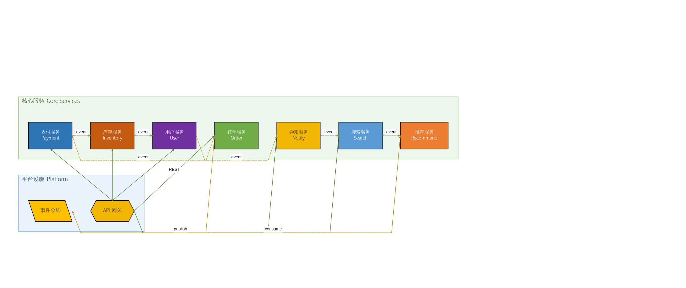
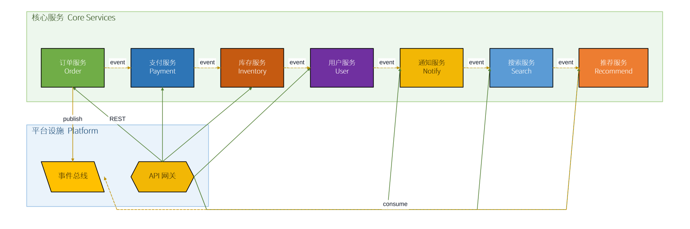
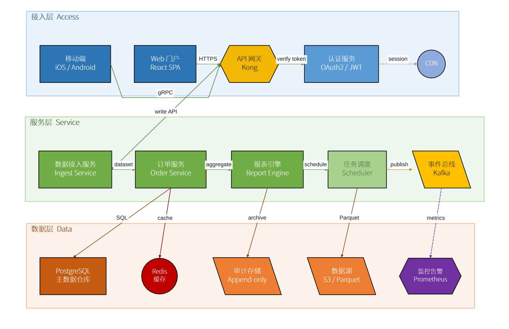
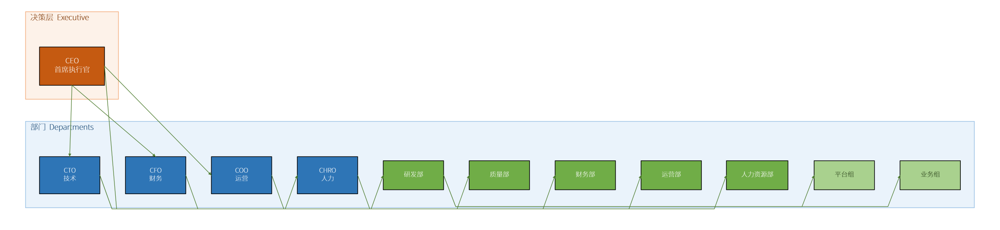
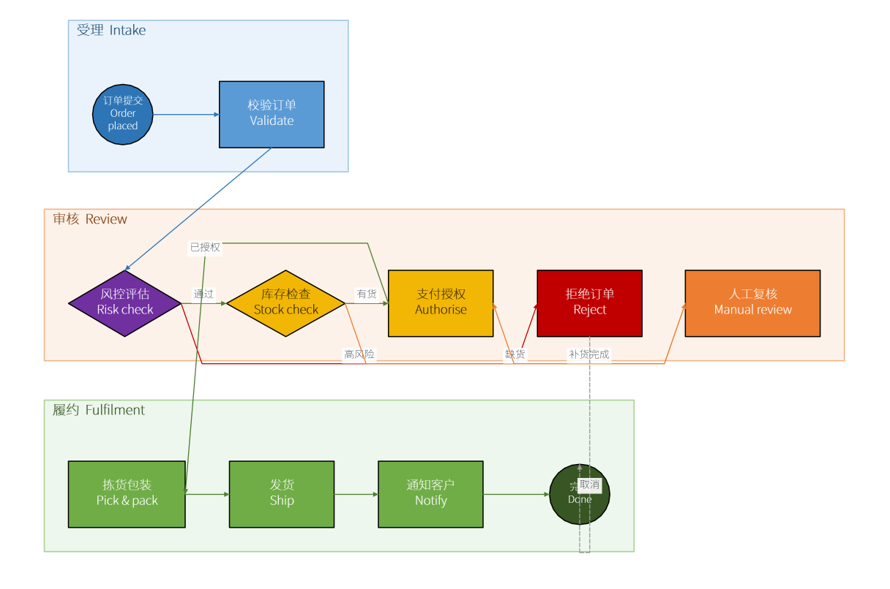

# Phase 7.1 真实制图能力基线报告

**基线建立时间：** 2026-11-17，基于 `967f967` + Gate A 审计期间的三项修复
**生成方式：** 全部由 Engine 实际执行，无人工绘制
**对照用途：** 后续所有改造必须与本报告的实测数字比较

---

## 1. 基线的构成

任务 §4.4 要求"基线必须真实生成"。本基线由三部分组成：

| 组成 | 内容 | 位置 |
| --- | --- | --- |
| 基准语料 | 6 族 × 3 档 + 8 故障注入 | `benchmarks/` |
| 端到端案例 | 6 个真实场景 | `demo/phase7/` |
| 实测产出 | VSDX + PNG + SVG + 质量报告 | 同上 |

**审计前后对照**：Gate A 期间发现并修复了 3 个缺陷（G1 嵌套容器、G2 流水线顺序、
G2b 排序反转）。本基线记录了**修复后**的状态，并在 §5 给出修复前后的数字。

---

## 2. 基准语料实测（修复后）

执行命令（对每个案例）：

```bash
vsdx-tool create --input benchmarks/<family>/<case>.json \
  --output out.vsdx --layout auto --fit-text --fit-page --recenter
vsdx-tool check-layout --input out.vsdx --json
```

| 族 | simple | medium | complex |
| --- | --- | --- | --- |
| architecture | 96 | 98 | 98 |
| microservices | 94 | 98 | 98 |
| workflow | 96 | 96 | 92 |
| network | 96 | 96 | 92 |
| org | 96 | 98 | 92 |
| hybrid | 96 | 92 | 92 |

**18/18 硬约束通过。**

但同时必须记录：**硬约束通过 ≠ 视觉合格**。见 §4 的视觉审查。

---

## 3. 十类图形覆盖矩阵

任务 §4.1 要求至少覆盖十类。逐项对照：

| # | 类别 | 覆盖情况 | 证据 | 缺口 |
| --- | --- | --- | --- | --- |
| 1 | 软件分层架构图 | ✅ 完整 | `architecture/*` | — |
| 2 | 微服务架构图 | ✅ 完整 | `microservices/*` | 扇出布线质量差（§4） |
| 3 | 复杂业务流程图 | ✅ 完整 | `workflow/*` | — |
| 4 | **跨职能泳道图** | ❌ **无法表达** | 无泳道模型 | 缺 `Lane` 概念（G4） |
| 5 | 系统集成关系图 | ⚠️ 近似 | `hybrid/medium` | 只能靠容器模拟 |
| 6 | 数据流架构图 | ✅ 完整 | `hybrid/complex` | — |
| 7 | 树形层级图 | ✅ 完整 | `org/*` | — |
| 8 | 网络拓扑图 | ✅ 完整 | `network/*` | — |
| 9 | **多层嵌套架构图** | ⚠️ **修复后可用** | 见 §5 G1 | Visio 内层级已写入，但未见原生验证 |
| 10 | 混合布局综合架构图 | ❌ **仅单策略** | — | 无"区域内不同策略"（G3） |

**结论：10 类中 6 类完整覆盖，2 类近似/需修复后验证，2 类无法表达。**

---

## 4. 视觉审查记录（任务 §5.3）

任务明确要求区分"自动检测 / 规则辅助 / 人工视觉"。本节是**人工视觉审查**，
逐张打开 PNG 判定。

### 4.1 microservices/complex — 修复前后差异显著

**修复前**（G2 未修，机器评分 90/100，硬约束全过）：



观察：页面右侧约 **1/3 完全空白**，内容挤在左侧；连线在底部形成横贯数英寸的走廊。

机器评分 90 —— **这是"指标合格但视觉不合格"的典型**。

**修复后**（G2 + G2b 已修，评分 98）：



观察：
- 右侧空白消失（7.09" → 0.86"）
- 服务链左右顺序正确（Order → Payment → Inventory → …）
- 仍存在**扇出连线问题**：7 条连线从同一网关发出，多条压到底部

**判定：** 可交付，但布线不专业。缺陷 G6（未修）。

### 4.2 architecture/complex — 视觉合格



观察：三条色带清晰分离，节点对齐，连线短且直，层级明确。
**判定：可交付，视觉合格。**

### 4.3 org/complex — 视觉合格



观察：层级清楚，同级对齐，根节点居中于顶部。
**判定：可交付，视觉合格。**

### 4.4 workflow/complex — 基本合格



观察：判断分支清晰，异常路径用虚线区分。
**判定：可交付。**

### 4.5 视觉审查的局限声明

以上审查由当前 Agent 直接查看 PNG 完成。**不是**独立的专业视觉设计师评审，
也未在打印尺度下检查字号可读性。任务 §5.3 要求"如果无法进行可靠视觉审查，
应当明确标记为未完成"——本审查属于**可用的初步审查**，不能替代专业设计师验收。

---

## 5. 审计期间发现并修复的缺陷（前后对比）

### G2：create 流水线顺序错误

| | 修复前 | 修复后 |
| --- | --- | --- |
| 顺序 | FitPage → Layout → Route | Layout → Containers → Recenter → FitPage → Route |
| microservices/complex 页面 | 20.45" 宽 | 14.22" 宽 |
| 右侧空白 | **7.09"** | **0.86"** |
| 评分 | 90 | 98 |

### G2b：层内排序反转

| | 修复前 | 修复后 |
| --- | --- | --- |
| 依据 | 前驱节点平均 X（源点 = MaxValue） | 图内拓扑序 + 作者 X 破平 |
| 简单链 A→B | A 排在 B 之后 | A 在 B 之前 |
| 对作者坐标的依赖 | 结果随作者的 X 改变 | 与作者 X 无关 |

### G1：嵌套容器结构丢失

| | 修复前 | 修复后 |
| --- | --- | --- |
| `Parent` cell | 0 个 | 1 个 |
| 读回 `ParentId` | `None` | `outer` |
| 父容器成员 | 仅 `c` | `c, a, b`（含传递成员） |

---

## 6. 六类端到端案例

任务 §4.3 要求 `Structured Input → Engine Execution → … → VSDX Inspection` 全链路。
现有基准语料已覆盖结构维度，但**尚未产出带 DesignSpec 的六案例**——
这属于 Phase 7.5 的工作，本 Gate 只建立基线。

已具备的案例产物：

| 案例 | 输入 | VSDX | PNG | 评分 | 可交付 |
| --- | --- | --- | --- | --- | --- |
| 分层架构 | `architecture/complex.json` | ✅ | ✅ | 98 | 是 |
| 微服务 | `microservices/complex.json` | ✅ | ✅ | 98 | 是（布线待改） |
| 业务流程 | `workflow/complex.json` | ✅ | ✅ | 92 | 是 |
| 网络拓扑 | `network/complex.json` | ✅ | ✅ | 92 | 是 |
| 组织结构 | `org/complex.json` | ✅ | ✅ | 92 | 是 |
| 混合架构 | `hybrid/complex.json` | ✅ | ✅ | 92 | 是 |

产物位于 `benchmarks/_artifacts/`。

---

## 7. 基线中的失败与未覆盖项

任务 §9 要求"不得只展示成功案例"。如实记录：

| 项 | 状态 | 说明 |
| --- | --- | --- |
| 泳道图 | **无法生成** | 无 `Lane` 模型概念，只能用容器近似 |
| 混合布局 | **无法生成** | 整页只能一种策略 |
| 局部重排 | **无法做到** | 修复只能整页重排 |
| 扇出布线 | **质量差** | 7 条线从同一点发出，视觉不专业 |
| 标题/图例/注释 | **无** | 无视觉组件体系 |
| L4 Visio 原生行为 | **无法验证** | 无 Windows + Visio |
| 超大图性能 | **未测** | 最大案例约 14 节点 |

---

## 8. 基线数字速查（后续对照用）

```
基准 18 例硬约束通过率      : 18/18
基准评分区间               : 92 – 98
最大单页右侧空白（ms/complex）: 0.86"
嵌套容器 ParentId 读回      : 成功
故障注入检出率             : 8/8
测试总数                   : 235
```

后续任何改造若使上述任一项退化，必须说明原因。
