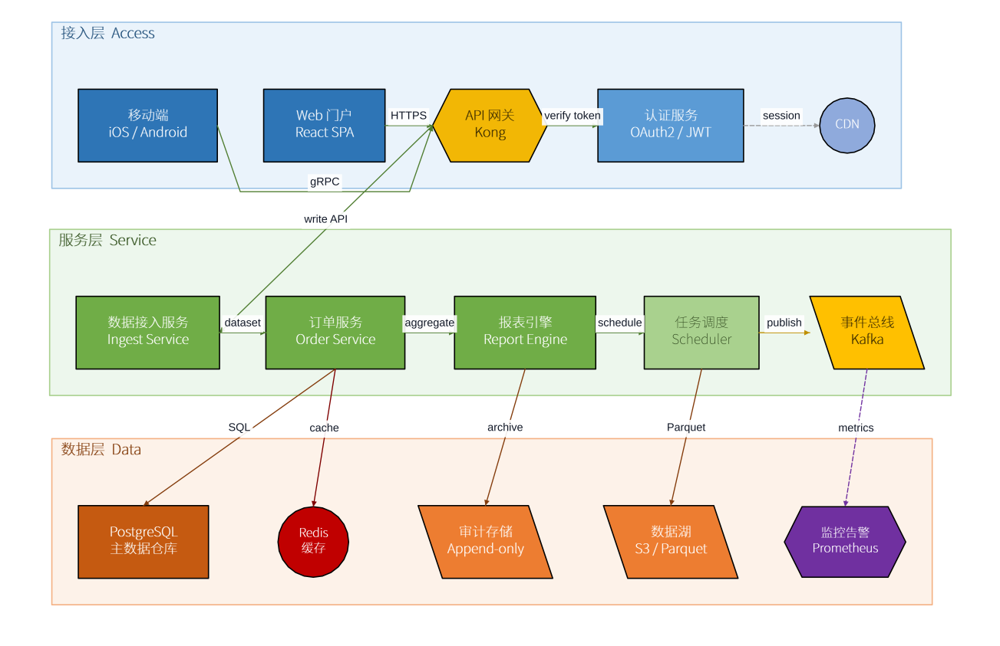

# Phase 8.0 现状审计

**审计对象：** `vsdx-engine` @ `9f6217881275ea0080bc5ac600a9f976169e142a`
**审计日期：** 2026-11-17
**审计方式：** 读源码 + 反射探测依赖库 + 实际生成/编辑/回读 VSDX + 打开真实 PNG
**基线：** 283 项测试通过，构建 0 warning

---

## 0. 审计方法

拒绝采信：README 描述、既往阶段报告结论、测试方法名、接口声明存在即认为能力存在。

每项结论必须落在：

| 证据类型 | 本次做法 |
| --- | --- |
| 源码 | 文件+行号，可 grep 复核 |
| 运行时探测 | 反射枚举依赖库公开成员 |
| 产物检查 | 解包 VSDX XML / 读回模型 / 打开 PNG |
| 实际执行 | 生成、编辑、回读、渲染完整链路 |

---

## 1. 最重要的单项发现：依赖库能力被大量闲置

这是本次审计对 Phase 8 影响最大的一条，也是**改变技术路线判断**的一条。

`OfficeIMO.Visio` 3.6.1 公开 API 规模：

```
public types        : 256
VisioShape members  : 162
VisioPage members   : 299
VisioDocument members: 104
```

**而本项目实际使用的类型只有 3 个：**

```console
$ grep -ohE "OfficeIMO\.Visio\.[A-Za-z]+" src/Vsdx.Adapters/*.cs src/Vsdx.Renderer/*.cs | sort | uniq -c
     10 OfficeIMO.Visio.VisioPage
      6 OfficeIMO.Visio.VisioShape
      1 OfficeIMO.Visio.VisioConnector
```

### 1.1 未被使用但已存在的能力

通过反射枚举确认以下公开 API **已存在于依赖库中**，而项目从未调用：

| 能力 | API | 项目现状 |
| --- | --- | --- |
| 母版导入 | `VisioDocument.ImportMasters` / `ImportMastersAndGet` / `ImportStencilMasters` / `LearnMastersFromVsdx` | **从未使用** |
| 母版集合 | `VisioDocument.Masters`、`UseMastersByDefault` | 未使用 |
| Stencil 目录 | `VisioStencilCatalog.Load/Save/ToBytes` | 未使用 |
| Stencil 资产元数据 | `VisioStencilShape.{Id,Name,Category,DefaultWidth,DefaultHeight,SourceLicense,SourceAttribution,PreviewImage,SourceConnectionPoints,IsSupported}` | 未使用 |
| Stencil 节点 | `VisioGraphDiagramBuilder.StencilNode(id,text,stencil)` | 未使用 |
| 标注（Callout） | `VisioCalloutExtensions.AddCallout`、`VisioCalloutOptions` | 未使用 |
| 批注（Comment） | `VisioCommentExtensions`、`VisioCommentOptions`（作者/时间/线程） | 未使用 |
| 图层 | `VisioLayer`、`VisioLayerRenderMode`、`VisioShape.LayerNames` | 部分（读取） |
| 容器高级 | `VisioContainerEditingExtensions`、`VisioContainerInfo` | 未使用 |
| 数据图形 | `VisioDataGraphic`、`VisioDataGraphicInstance`、`VisioDataGraphicLegend` | 未使用 |
| 连接线高级 | `VisioConnectorRoutingOptions`、`VisioConnectorLineJumpCode`、`VisioConnectorRerouteBehavior` | 未使用 |
| Shape→Master 绑定 | `VisioShape.Master`（可写）、`MasterShapeId`、`MasterShape` | 未使用 |

**结论：** 任务 §8.3 设想"建立资产系统"所需的底层能力，
**依赖库已经提供了大半**（Stencil 目录、母版导入、资产元数据含许可证与归属）。
当前项目用一个 17 项硬编码字符串表（`MasterCatalog`）覆盖了这一切。

这直接改变 Phase 8.3 的判断：**不需要自建资产系统，需要的是接入已有 Stencil 机制。**

### 1.2 已实测验证该结论

不是只看到方法签名就下结论。实际执行：

```csharp
var doc = VisioDocument.Create("t.vsdx");
Console.WriteLine($"masters={doc.Masters.Count}");     // → masters=0
var got = doc.ImportMastersAndGet("/path/to/base.vsdx");
Console.WriteLine($"got={got.Count}");                  // → got=5
Console.WriteLine($"masters now={doc.Masters.Count}");  // → masters now=5
// 导入的母版：Circle / Hexagon / Rectangle / Parallelogram / Process
```

**母版导入真实可用**，目前完全闲置。

---

## 2. 已证实的能力缺口（含实测证据）

### 2.1 【P0】外部 VSDX 编辑会注入矩形几何，覆盖原始形状

**这是本次审计发现的最严重缺陷**，此前从未被测试覆盖。

**实测：** 取一个外部 VSDX（4 shape + 1 container，无 Geometry 段、无 Master 引用），
模型只加 1 个节点 1 条线，执行 `update`：

```
original: {'shapes': 6, 'geom': 0, 'prop': 1, 'conn': 2}
edited  : {'shapes': 8, 'geom': 8, 'prop': 1, 'conn': 4}
```

**每一个原有 shape 都被注入了 Geometry 段**：

```
ORIGINAL:                      EDITED:
  10 Container    geom=0    →    10 Container    geom=1
  1  Rectangle    geom=0    →    1  Rectangle    geom=1
  2  Rectangle    geom=0    →    2  Rectangle    geom=1
  3  Rectangle    geom=0    →    3  Rectangle    geom=1
  7  Connector    geom=0    →    7  Connector    geom=1
```

注入内容是硬编码矩形：

```xml
<Section N="Geometry" IX="0">
  <Row T="MoveTo" IX="1"><Cell N="X" V="0"/><Cell N="Y" V="0"/></Row>
  <Row T="LineTo" IX="2"><Cell N="X" V="2"/><Cell N="Y" V="0"/></Row>
  ...
```

**影响判定：**

- 对本身是矩形的形状，几何等价，**视觉无损**
- 对圆 / 菱形 / 自定义路径 / 依赖 Master 的形状，**原始形状被矩形覆盖**
- 该外部样本恰好全是矩形，所以掩盖了问题

**为什么是 P0：** 任务 §3.3 明确要求"保存时不破坏未修改的原生特性"。
当前行为违反该原则，且**静默发生**——没有任何警告或兼容性报告条目。

**已确认未测试：**

```console
$ grep -rn "Geometry" tests/Vsdx.Tests/*.cs
（无结果）
```

**根因推测（需 Phase 8.1 验证）：** OfficeIMO 在 `Save` 时为没有 Geometry 段的
shape 合成默认矩形，而非保留"无显式几何、依赖 Master"的原始状态。

### 2.2 【P1】`DesignSpec.Theme.Palette` 是空声明

```console
$ grep -rn "Palette" src/ --include=*.cs
src/Vsdx.Protocol/DesignSpec.cs:83:    public string? Palette { get; set; }
src/Vsdx.Model/DiagramModel.cs:205:  public string? Palette { get; set; }
```

**仅有声明，无任何读取方。** 协议 Schema 中允许调用方设置 `theme.palette`，
执行时被完全忽略，**且不报告未满足**——违反项目自己定的契约
（"声明必须被满足或报告"）。

对比：同级的 `theme.roleColors` 和 `theme.background` 是**真正执行**的
（`DesignSpec.cs:224-244`）。

### 2.3 【P1】`ShapeOrder` 读取但从不写入，Z-order 每次保存都丢

```console
$ grep -n "ShapeOrder" src/Vsdx.Adapters/OfficeImoDocumentWriter.cs src/Vsdx.Engine/*.cs
（无结果）
```

读取端 `OfficeImoDocumentReader.cs:281` 记录了 `model.ShapeOrder = shapeOrder`，
但写入端从不使用。**Z-order 是任务 §4.5 明确要求保持的项。**

### 2.4 【P1】协议层只支持单页

```console
$ python3 -c "...IR keys..."
IR top-level keys: ['containers','edges','id','irVersion','kind','metadata','nodes','title']
has pages field: False
```

`DiagramIr` 无 `pages` 字段，`DiagramIrConverter.ToDiagram` 硬编码
`page.Id = "page-0"` 且只 `Add` 一次（`DiagramIr.cs:154`）。

但底层模型、写入器、读取器、渲染器**都支持多页**
（`OfficeImoVsdxRenderer.cs:45` 有 `multiPage` 分支）。
**这是协议缺口，不是底层能力缺口。**

### 2.5 【P1】MasterCatalog 只有 17 个基础形状，全部别名收敛到这 17 个

```console
built-ins: Rectangle Ellipse Square Circle Dynamic connector Diamond Triangle
           Process Decision Data Preparation Manual operation Off-page reference
           Parallelogram Hexagon Trapezoid Pentagon Text Box Container
```

别名目标集合与内置集合**完全相同**——没有任何语义形状。

`DiagramIrConverter.ShapeForRole` 的映射：

```
gateway→Hexagon  database→Process  queue→Parallelogram  actor→Circle
decision→Diamond  monitor→Hexagon  service/other→Rectangle
```

即 **database 与 service 都渲染成矩形**，语义在视觉上不可区分。
任务 §4.3 要求"从硬编码 Master 映射演进为可扩展资产机制"，这正是缺口。

### 2.6 【P2】容器间距全部为绝对英寸常量

```console
ContainerPaddingX     = 0.30"
ContainerHeading      = 0.46"
ContainerPaddingBottom= 0.22"
PageMargin            = 0.55"
MinNodeWidth          = 1.30"
PreferredAspect       = 2.2
```

不随字号、页面尺寸或图形密度缩放。小页面与大页面使用同一套间距，
视觉密度无法按设计意图调整。

### 2.6b 【P0/P1】自定义几何读回被错误标记为矩形节点

**实验发现：** 向 VSDX 注入一个含 4 段折线的自定义 Geometry 形状，
经 `export-model` 读回后：

```
nodes:
   a  shape=Rectangle text='A'
   b  shape=Rectangle text='B'
   4  shape=Rectangle text=None   ← 自由路径被当成无文本的矩形节点
```

**影响：** 读取外部含自定义几何的文件时，路径形状会变成"空矩形节点"。
若上层随后执行 `update`，该形状会被当作矩形节点重写——**原始路径可能被破坏**。

**未验证：** 本次实验中 `update` 后几何仍保留（`rows=4`，锯齿坐标在），
说明当前写入器"不认识所以不改"反而保护了它。
但这是**偶然的保护**，不是设计保证——一旦 8.1 引入 `FreePath` 读取，
必须同时确保写入路径正确。

### 2.7 【P2】无独立文本 / 图片 / 自由路径对象

| 对象 | 是否存在 | 证据 |
| --- | --- | --- |
| 独立文本（标题、注释、图例） | ❌ | `grep -rn "Title\|Legend\|Annotation" src/Vsdx.Model` 仅 TypeScale 字号档 |
| 图片 | ❌ | 模型无字段；依赖库也无 image API（反射确认） |
| 自由路径 / 自定义几何 | ❌ | `Node.Shape` 是字符串，只能选内置 master |
| 复合符号 | ❌ | 无实现 |

任务 §4.1 列的 11 类表达能力中，当前只能表达"几何图形（17 种）+ 连接关系 + 图形数据"。

**注意：** 图片能力在依赖库中**没有高层 API**（反射未发现 image/picture）。
但这**不等于格式层不支持**——实验 2 已证明手写 `ForeignData` + media 关系可行
（校验 VALID、渲染成功）。见 `technical-experiments.md`。

需区分两件事：

| 层 | 状态 |
| --- | --- |
| 依赖库高层 API | ❌ 无 |
| VSDX 包格式 | ✅ 支持（实验已验证） |
| 本项目模型字段 | ❌ 无 |
| 渲染器显示真实位图 | ❌ 仅占位框 |

**结论：需要自行注入 XML，技术风险已通过实验消除。**

---

## 3. 特别调查：OfficeIMO 能力边界

任务 §5 要求"检查 OfficeIMO.Visio 的真实能力"。结论按"库有/库无"分类：

### 3.1 库已提供、项目未用（应接入，非自建）

母版导入与 Stencil 目录、Callout、Comment、Data Graphic、连接线高级路由选项、
图层 API、容器编辑扩展、`VisioShape.Master` 绑定。

### 3.2 库未提供、必须自行实现

| 能力 | 说明 |
| --- | --- |
| 图片嵌入 | 库无高层 API，但**实验 2 已验证**手写 `visio/media/*` + 关系 + `ForeignData` 可行 |
| Z-order 写入 | 未发现显式 z-order API，需依赖 shape 写入顺序 |
| SVG 嵌入 | 未发现；需 `ForeignData` + 关系 |
| 自定义 Geometry 路径 | `VisioShape` 无 Geo/Path 属性；需 XML patch |

### 3.3 库不暴露、但可通过 XML patch

现有的三个 patch 桥已证明这条路可行：

| Bridge | 用途 | 风险 |
| --- | --- | --- |
| `VisioMetadataBridge` | docProps 自定义属性 | 低（只增） |
| `VisioNestingBridge` | 容器 `Parent` cell | 中（依赖文本 join） |
| （新增）`VisioNestingBridge` 读取路径 | 解析 Parent cell | 中 |

**技术债判定：** 当前 patch 数量为 2，继续增加需谨慎。
若图片/路径/SVG 都要 patch，总数会到 5+，**应重新评估是否直接操作 OPC**
而非继续在 OfficeIMO 之上打补丁。

---

## 4. 外部 VSDX 保真能力现状

| 特性 | 读取 | 模型可见 | 可编辑 | 保存保留 | 证据 |
| --- | --- | --- | --- | --- | --- |
| Shape / 文字 / 样式 | ✅ | ✅ | ✅ | ✅ | `ExternalVsdxTests` |
| 连接线端点 | ✅ | ✅ | ✅ | ✅ | `RoundTrip_ConnectorEndpointsSurvive` |
| 容器（`msvStructureType`） | ✅ | ✅ | ✅ | ✅ | 实测 3 个 container marker |
| 嵌套容器（`Parent` cell） | ✅ | ✅ | ✅ | ✅ | Phase 7 修复 |
| Shape Data（Property） | ✅ | ✅ | ✅ | ✅ | 实测 `prop: 1 → 1` |
| 无 Geometry 段的形状 | ✅ | 部分 | ❌ | **❌ 被注入矩形** | §2.1 |
| 自定义 Geometry（手绘） | ✅ | ❌ | ❌ | ⚠️ 未验证 | — |
| Z-order | ✅ | ✅ | ❌ | **❌ 丢失** | §2.3 |
| 图层 | ✅ | ✅ | ❌ | ⚠️ 未验证 | — |
| 图片 | — | ❌ | ❌ | ⚠️ 未验证 | 无样本 |
| 主题 / StyleSheet | ✅ | ❌ | ❌ | ⚠️ 未验证 | — |
| 数据图形 | ✅ | ❌ | ❌ | ⚠️ 未验证 | — |

**"未验证"不等于"保留"**，也不等于"不保留"。缺少样本就没有结论。

### 4.1 无操作往返的结构保真实测

对一个自建文件做 `export-model → update`（零改动）：

```
before: shapes=26 geom=26 users=12 masters=12 cells=48
after : shapes=26 geom=26 users=12 masters=12 cells=48
cells lost: []   cells added: []
```

**结构完全保真**，只有 XML 字节数变化（49,600 → 52,472，来自格式化）。
无操作往返是可靠的；**问题只出现在"外部无几何形状 + 有修改"的组合**。

---

## 5. 真实图形产物审查

### 5.1 architecture/complex（98/100，硬约束通过）



**观察：**

| 维度 | 评价 |
| --- | --- |
| 分层结构 | ✅ 三条色带清晰，标题左对齐 |
| 节点对齐 | ✅ 行内基线一致 |
| 形状语义 | ⚠️ database 与 service 同为矩形，仅靠颜色区分 |
| 连线 | ⚠️ 三条线汇聚到"订单服务"，形成扇入，其中两条为斜线 |
| 视觉层次 | ✅ 容器 > 节点 > 标签三层可辨 |
| 留白 | ✅ 利用率良好 |

**判定：可交付，但形状语义贫乏。** 这正是 §2.5 缺口在真实产物上的体现。

### 5.2 与我此前报告的差异

Phase 7 报告称该图"视觉合格"。本次审查更严格地指出：
**database/service/queue 的形状差异仅靠颜色，形状本身无区别**
（数据库是矩形，和普通服务一样）。这不影响"可交付"，但达不到"专业"。

---

## 6. 测试体系审计

| 检查项 | 结果 |
| --- | --- |
| 测试总数 | 283，全通过 |
| 是否有真实断言 | ✅ 多数断言几何数值/代码集合 |
| 弱测试（只查存在/非空） | 少量渲染后 `File.Length > 1000` |
| 端到端覆盖 | ✅ `IntegrationTests`、`BenchmarkTests` |
| 失败案例 | ✅ 8 个故障注入 |
| **外部 VSDX 无几何形状** | ❌ **完全未覆盖**（§2.1） |
| **Z-order** | ❌ 未覆盖 |
| **几何保真** | ❌ `grep "Geometry" tests/` 无结果 |
| **多页协议** | ❌ 未覆盖 |

**最关键的一条：** §2.1 的 P0 缺陷能在 283 项测试全绿的情况下存在，
说明当前测试体系的盲区正是"外部文件的**非典型**构造"。
现有外部样本恰好全是无 Geometry 的矩形，掩盖了注入问题。

---

## 7. 结论

### 7.1 应当保留

- 四层分层架构（Model / Engine / Adapters / Protocol）
- 布局策略体系（Layered / Flow / Tree / Grid / Swimlane / Manual）
- ORM 之外的"显式状态"设计：`LayoutIssue` 带 `RootCause` / `RecommendedFix` / `SuggestedLevel`
- 硬/软约束分离与分数归零机制
- 三层协议与 `unmetConstraints` 契约
- 增量编辑与稳定 ID（`User.VsdxModelId`）
- 兼容性报告机制（不静默丢弃）

### 7.2 应当修改

| # | 项 | 优先级 |
| --- | --- | --- |
| 1 | 外部无几何形状被注入矩形 | **P0** |
| 2 | `Palette` 声明不执行 | P1 |
| 3 | `ShapeOrder` 不写入 | P1 |
| 4 | 协议层单页限制 | P1 |
| 5 | MasterCatalog 语义贫乏 | P1 |
| 6 | 间距绝对值 | P2 |

### 7.3 应当新增

- 通用图形对象（独立文本、区域、自由路径）——**最小化**，不做万能对象
- 资产接入（基于已有 Stencil API，非自建）
- 多区域构图协调

### 7.4 技术债

| 债 | 严重度 | 建议 |
| --- | --- | --- |
| XML patch 桥累积（当前 2 处，读取路径也依赖） | 中高 | 图片/路径若需 patch，应评估直接操作 OPC |
| 嵌套容器用"标题文本"作 join key | 中 | 若 OfficeIMO 改文本写入方式会静默失效 |
| 容器间距硬编码 | 低 | 参数化 |

### 7.5 不应由 Engine 实现

- 判断图形该表达什么业务含义
- 决定是否拆图 / 是否插入语义聚合节点
- 选择视觉设计风格（Engine 只执行 DesignSpec）
- 领域专用图标库（应由外部资产包提供）
- L4 Visio 原生验收替代方案（无法验证就是无法验证）

### 7.6 值得继续利用的第三方库

**OfficeIMO.Visio 值得深度利用而非替换。** 理由：§1 已证明其能力远超当前使用面，
且 Stencil 资产元数据已包含许可证/归属字段，正好匹配任务 §8.3 要求。

MIT 许可，无进程依赖。不建议引入 Graphviz（Phase 7 已论证）。

### 7.7 推荐的最小演进方案

**不做大重构。** 按以下顺序，每步都有独立验收：

1. **修复 P0 几何注入**（Phase 8.1 前置，因为它是"保真"底线）
2. **接入现有 Stencil/Master API**（Phase 8.3 大部分工作已被库完成）
3. **最小通用对象**：仅新增 `TextBlock` 与 `FreePath`，不做通用 Shape 树
4. **Palette / 字体层级真实执行**（Phase 8.2）
5. **多区域构图**（Phase 8.4，基于现有容器机制）
